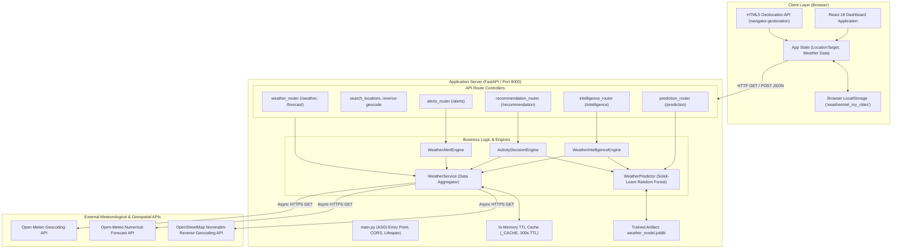

# ACADEMIC PROJECT REPORT
## AI-Based Weather Intelligence & Decision Support System

---

### Project Information & Submission Details

- **Project Title**: AI-Based Weather Intelligence & Decision Support System
- **Candidate Name**: `[ENTER YOUR FULL NAME HERE]`
- **University Roll Number / Registration ID**: `[ENTER YOUR ROLL / REGISTRATION NUMBER]`
- **Department**: Department of Computer Science and Engineering / Information Technology
- **Institution**: `[ENTER YOUR COLLEGE / UNIVERSITY NAME]`
- **Academic Degree**: Bachelor of Technology (B.Tech) / Bachelor of Engineering (B.E.) / Bachelor of Science (B.Sc)
- **Academic Year / Semester**: `[ENTER ACADEMIC YEAR / SEMESTER, e.g., 2025–2026 / 8th Semester]`
- **Project Supervisor / Guide**: `[ENTER SUPERVISOR / PROFESSOR NAME AND DESIGNATION]`
- **Date of Submission**: `[ENTER SUBMISSION DATE, e.g., November 2026]`

---

## Declaration & Acknowledgements

### Student Declaration
I hereby declare that the project titled **"AI-Based Weather Intelligence & Decision Support System"** submitted by me in partial fulfillment of the requirements for the award of the degree is a bona fide record of original work carried out by me under the guidance of my project supervisor. All technical findings, source code implementations, data analysis, and architectural models documented herein reflect the actual verified state of the developed software system.

**Signature**: ___________________________  
**Date**: `[SUBMISSION DATE]`

---

## Executive Summary & Abstract

Traditional consumer weather applications suffer from a significant usability gap: they present isolated, raw numerical measurements (e.g., barometric pressure in hectopascals, relative humidity percentages, or wind speeds in kilometers per hour) without translating those measurements into actionable, domain-specific guidance or explaining the physical factors driving the forecast. Furthermore, commercial applications rarely disclose the distinction between physics-based simulations and empirical statistical learning.

This project designs, implements, and evaluates an end-to-end **AI-Based Weather Intelligence and Decision Support System**. The system bridges the gap between raw meteorological telemetry and everyday operational human decision-making across four operational domains: **Transportation & Commuting**, **Outdoor Public Events**, **Athletics & Sports**, and **Agricultural Operations**.

The platform is architected as a modular, full-stack application:
1. **Frontend Layer**: Built with **React 18**, **TypeScript**, **Tailwind CSS**, **Recharts** (declarative SVG charts), and **Leaflet** (interactive OpenStreetMap mapping). It features an interactive location search engine with prefix and substring auto-completion, browser-persisted shortcut cities via `localStorage`, and device GPS geolocation with reverse geocoding.
2. **Backend Services Layer**: Developed using **FastAPI** (Python 3.13) under an asynchronous ASGI architecture (Uvicorn), with in-memory time-to-live (TTL) caching (300 seconds), automated WMO weather interpretation, and strict Pydantic validation.
3. **Machine Learning Predictive Engine**: A custom **Scikit-Learn Random Forest Classifier** trained on **35,061 chronological hourly observations (2021–2024)** obtained from the Open-Meteo Historical Weather Archive. The model forecasts short-range rainfall occurrence ($t+1$ to $t+3$ hours ahead) using engineered physical features including 3-hour barometric pressure tendencies, moisture gradients, and past precipitation accumulation. Evaluated on a chronological holdout test set (7,013 samples), the Random Forest achieved an **accuracy of 80.21%**, an **ROC-AUC of 0.8792**, and a **recall of 80.60%** on precipitation events.
4. **Decision Support & Intelligence Engines**: Rule-based engines synthesize live atmospheric telemetry, numerical weather prediction (NWP) physics, and machine-learning rainfall probabilities to produce objective 0–100 suitability scores, risk classifications (Low, Moderate, High, Severe), and human-readable operational precautions.

**Keywords**: *Meteorological Informatics, Machine Learning, Random Forest Classifier, Explainable Decision Support System, Time-Series Forecasting, FastAPI, React, Open-Meteo, Leaflet Geospatial Mapping.*

---

## Table of Contents

1. [Introduction & Problem Formulation](#1-introduction--problem-formulation)
2. [Academic Distinction: Physics Simulations (NWP) vs. Empirical ML](#2-academic-distinction-physics-simulations-nwp-vs-empirical-ml)
3. [System Requirements & Technology Stack](#3-system-requirements--technology-stack)
4. [System Architecture & Data Flow](#4-system-architecture--data-flow)
5. [Dataset Engineering & Preprocessing Methodology](#5-dataset-engineering--preprocessing-methodology)
6. [Machine Learning Methodology & Experimental Benchmarks](#6-machine-learning-methodology--experimental-benchmarks)
7. [Weather Intelligence & Decision Support Methodology](#7-weather-intelligence--decision-support-methodology)
8. [Application Features & User Interface Implementation](#8-application-features--user-interface-implementation)
9. [API Architecture & Integration Specifications](#9-api-architecture--integration-specifications)
10. [Verification, Testing & Quality Assurance](#10-verification-testing--quality-assurance)
11. [Installation, Configuration & Deployment Guide](#11-installation-configuration--deployment-guide)
12. [Security, Privacy & Architectural Limitations](#12-security-privacy--architectural-limitations)
13. [Conclusion & Future Enhancements](#13-conclusion--future-enhancements)
14. [Academic & Technical References](#14-academic--technical-references)
15. [Glossary of Meteorological & Computing Terms](#15-glossary-of-meteorological--computing-terms)
16. [Viva Voce & Oral Defense Preparation Guide](#16-viva-voce--oral-defense-preparation-guide)

---

## 1. Introduction & Problem Formulation

### 1.1 Background & Motivation
Atmospheric conditions directly govern human safety, operational logistics, and economic outcomes across numerous societal sectors:
- **Transportation**: Heavy rain, surface ponding, and high crosswinds increase vehicle stopping distances, cause hydroplaning on highways, and impair visual range.
- **Outdoor Events & Gatherings**: Wind gusts destabilize temporary staging, tents, and marquees, while sudden convective showers disrupt attendee comfort and cause electrical hazards.
- **Athletics & Outdoor Sports**: High ambient heat paired with elevated humidity induces dangerous heat exhaustion, while saturated turf reduces traction and increases injury risk.
- **Agriculture & Farming**: Foliar spraying of agrochemicals requires a strict meteorological window—winds must remain between 5 and 15 km/h to prevent spray drift onto non-target areas, and rain must not occur within 1 to 3 hours to prevent chemical wash-off.

Despite the abundance of weather data, conventional consumer weather portals focus primarily on passive meteorological reporting (e.g., "Partly Cloudy, 24°C, 1014 hPa"). They leave the critical step of *interpretation* entirely to the user. A novice user or small-scale farmer often does not know what a 3 hPa drop in pressure signifies or whether a 30 km/h wind allows safe pesticide application.

### 1.2 Problem Statement
To design, implement, and evaluate an explainable, full-stack weather intelligence and decision-support software application that:
1. Ingests verified global real-time weather observations and numerical forecasts without requiring commercial API subscriptions.
2. Trains an empirical machine-learning classifier on multi-year hourly meteorological records to predict short-range precipitation probability with high recall.
3. Automatically derives rule-based, domain-specific activity advisories with transparent scoring (0–100) and actionable precautions.
4. Delivers an interactive, highly responsive web dashboard with geospatial mapping, persistent personalization, and plain-language intelligence summaries.

### 1.3 Project Scope
- **Geographic Scope**: Real-time weather observation, geocoding, reverse geocoding, and decision support are globally capable across any inhabited coordinate worldwide.
- **Machine Learning Scope**: The empirical predictive model focuses specifically on **short-range precipitation classification ($t+1$ to $t+3$ hour window)** using surface atmospheric dynamics.
- **Domain Scope**: Four targeted operational domains: Travel & Commuting, Outdoor Events, Athletics, and Agriculture.

### 1.4 Known Limitations
- The underlying machine-learning model was trained on 4 years of continuous hourly surface observations from **London, United Kingdom** (a temperate maritime climate). While physics principles (falling pressure and high humidity preceding rain) are universal, regional convective dynamics in tropical monsoons or arid deserts may exhibit different threshold sensitivities.
- Live inference currently relies on real-time surface parameters and derives pressure/humidity trends based on available telemetry; it does not yet ingest full 3-dimensional Doppler radar reflectivity arrays.

---

## 2. Academic Distinction: Physics Simulations (NWP) vs. Empirical ML

A cornerstone of this project's academic design is the rigorous separation and complementary synthesis of two distinct paradigms in atmospheric science:

```
┌────────────────────────────────────────────────────────────────────────┐
│                   METEOROLOGICAL MODELING PARADIGMS                    │
└────────────────────────────────────────────────────────────────────────┘
                                    │
           ┌────────────────────────┴────────────────────────┐
           ▼                                                 ▼
┌─────────────────────────────────────┐   ┌─────────────────────────────────────┐
│  NUMERICAL WEATHER PREDICTION (NWP) │   │     STATISTICAL / EMPIRICAL ML      │
├─────────────────────────────────────┤   ├─────────────────────────────────────┤
│ • Governing Principle: Conservation │   │ • Governing Principle: Statistical  │
│   laws of classical fluid dynamics  │   │   pattern recognition & empirical   │
│   (Navier-Stokes, thermodynamics)   │   │   correlation                       │
│ • Execution: Global supercomputers  │   │ • Execution: Local Scikit-Learn     │
│   solving 3D grid differential eq.  │   │   Random Forest classifier          │
│ • Horizon: Medium to long range     │   │ • Horizon: Short-range "nowcasting" │
│   (24 hours to 7+ days)             │   │   (upcoming 1 to 3 hours)           │
│ • Data Source: Open-Meteo API       │   │ • Data Source: Local inference on   │
│   (aggregating DWD ICON, GFS, ECMWF)│   │   engineered historical features    │
└─────────────────────────────────────┘   └─────────────────────────────────────┘
                                    │
                                    ▼
┌────────────────────────────────────────────────────────────────────────┐
│                      WEATHER INTELLIGENCE SYNTHESIS                    │
│   Fuses NWP thermodynamic state with ML empirical precipitation risk   │
└────────────────────────────────────────────────────────────────────────┘
```

1. **Numerical Weather Prediction (NWP)**:
   - Uses fundamental laws of physics: Navier-Stokes momentum equations, the hydrostatic equation, the ideal gas law, and moisture continuity equations.
   - Solves non-linear partial differential equations over 3D atmospheric grid cells.
   - Ideal for synoptic-scale patterns and extended 24-hour to 7-day outlooks.
2. **Empirical Machine Learning**:
   - Uses historical observational telemetry to identify high-probability precursor patterns (e.g., a rapid barometric drop accompanied by a shrinking dew point spread and antecedent surface moisture).
   - Operates in milliseconds on lightweight commodity hardware without solving complex partial differential equations.
   - Ideal for short-range immediate decision support (1–3 hours).

---

## 3. System Requirements & Technology Stack

### 3.1 Technology Stack & Architectural Justification

| Layer | Technology | Version | Engineering Justification |
|---|---|---|---|
| **Client UI** | React | 18.3.1 | Declarative component model, virtual DOM diffing, concurrent rendering, and active community ecosystem for scientific dashboards. |
| **Language (UI)** | TypeScript | 5.5.3 | Enforces strict compile-time typing matching backend Pydantic schemas, eliminating `null`/`undefined` runtime errors in weather telemetry. |
| **Bundler & Tooling** | Vite | 6.4.5 | Fast Hot Module Replacement (HMR) using native ES modules, and Rollup production minification. |
| **CSS & Design** | Tailwind CSS | 3.4.17 | Utility-first CSS providing responsive layouts, dark slate design system, and responsive breakpoints (`sm`, `md`, `lg`). |
| **Data Visualization** | Recharts | 2.15.1 | Composable, declarative SVG charts optimized for responsive time-series area charts and bar charts. |
| **Mapping Engine** | Leaflet | 1.9.4 | Open-source, lightweight interactive mapping with custom HTML pins, without requiring commercial Google Maps API keys or billing. |
| **Backend Framework** | FastAPI | 0.115.12 | Modern, high-performance Python ASGI web framework with native async/await, automated OpenAPI (Swagger) documentation, and Pydantic validation. |
| **Web Server (ASGI)** | Uvicorn | 0.34.0 | Lightning-fast ASGI web server implementation based on `uvloop` and `httptools`. |
| **Async HTTP Client** | HTTPX | 0.28.1 | Fully asynchronous, connection-pooled HTTP client with timeouts for upstream Open-Meteo and Nominatim requests. |
| **Machine Learning** | Scikit-Learn | 1.6.1 | Gold-standard machine learning library for tabular data, providing robust Random Forest, Decision Tree, metrics, and preprocessing pipelines. |
| **Data Processing** | Pandas / NumPy | 2.2.3 / 2.2.3 | Time-series data manipulation, rolling window computations, shift operations, and vector arithmetic. |
| **Model Persistence** | Joblib | 1.4.2 | Optimized serialization for large NumPy arrays and Scikit-Learn tree models with internal compression. |
| **Testing Harness** | Pytest / AnyIO | 9.2.0 / 4.16.0 | Modern Python test framework supporting asynchronous test fixtures via ASGI transport (`ASGITransport`). |

---

## 4. System Architecture & Data Flow

### 4.1 High-Level Architecture Diagram



### 4.2 End-to-End Data Flow Scenarios

#### Scenario 1: Initial Application Load (Default Location: New Delhi)
1. User visits `http://localhost:5173`.
2. `App.tsx` initializes state with `DEFAULT_LOCATION` set to **New Delhi, India** (`lat: 28.6139`, `lon: 77.2090`).
3. An effect hook triggers `loadAllWeatherData(target)` which invokes five asynchronous requests concurrently via `Promise.all`:
   - `GET /weather/New%20Delhi?lat=28.6139&lon=77.209`
   - `GET /forecast/New%20Delhi?lat=28.6139&lon=77.209`
   - `GET /prediction/New%20Delhi?lat=28.6139&lon=77.209`
   - `GET /intelligence/New%20Delhi?lat=28.6139&lon=77.209`
   - `GET /alerts/New%20Delhi?lat=28.6139&lon=77.209`
4. Backend `WeatherService` checks its in-memory TTL cache (`_CACHE`). If missing or expired (> 300 seconds), it makes an asynchronous HTTPS request to Open-Meteo.
5. The received telemetry is mapped into Pydantic models and returned to the frontend.
6. React renders the Dashboard: Current Weather Card, 12-Hour Consecutive Forecast Trend Chart, Leaflet Map pin, Weather Predictions Card, Weather Intelligence Card, and Quick Metric Cards.

#### Scenario 2: "Use My Location" GPS Flow
1. User clicks the **"Use My Location"** button in `Navbar.tsx`.
2. Browser invokes `navigator.geolocation.getCurrentPosition({ enableHighAccuracy: true, timeout: 10000, maximumAge: 0 })`.
3. The device returns exact hardware GPS coordinates (e.g., `lat: 26.1158`, `lon: 91.7086` for Ahomgaon/Guwahati, Assam).
4. Frontend calls `GET /reverse-geocode?lat=26.1158&lon=91.7086`.
5. Backend queries the OpenStreetMap Nominatim API (`https://nominatim.openstreetmap.org/reverse?format=json&lat=...&lon=...`).
6. Nominatim parses address details: suburb (`Ahomgaon`), city (`Guwahati`), state (`Assam`), country (`India`).
7. If Nominatim is unreachable, backend executes a mathematical fallback using the **Haversine Great-Circle Distance** formula against a curated array of 65+ major global cities to select the nearest geographical center.
8. The resolved location is passed to `loadAllWeatherData`, seamlessly refreshing all weather cards, 12-hour trends, maps, and ML predictions for the user's exact physical coordinates.

#### Scenario 3: Real-Time Auto-Complete Search & "My Cities" Persistence
1. User clicks the `+` button in the "My Cities" bar or clicks into the search bar in `Navbar.tsx`.
2. If the search box is empty, backend `GET /search/locations` computes Haversine distances to return nearby suggested cities.
3. As the user types (e.g., `"Tok"`), debounced keystrokes send `GET /search/locations?query=Tok`.
4. Backend matches prefixes first (e.g., `Tokyo, Japan`), followed by substrings.
5. User can click any suggestion to load its weather, or click the `+` icon on the right side of the suggestion row to add it directly to **"My Cities"** without changing the currently viewed location.
6. Duplicate city additions are blocked.
7. The updated array is persisted in browser `localStorage` under key `weatherintel_my_cities`.

---

## 5. Dataset Engineering & Preprocessing Methodology

### 5.1 Dataset Provenance & Collection
To train a machine learning model capable of capturing continuous meteorological dynamics, real-world chronological data was collected via `backend/scripts/collect_dataset.py` from the **Open-Meteo Historical Weather Archive API**:
- **Geographic Station**: London, United Kingdom (`latitude: 51.5074`, `longitude: -0.1278`).
- **Data License**: Creative Commons Attribution 4.0 International (CC BY 4.0).
- **Time Horizon**: 2021-01-01 00:00:00 to 2024-12-31 23:00:00 (4 full calendar years).
- **Raw Observations**: **35,064 consecutive hourly records**.
- **Raw Features Extracted**:
  `time`, `temperature_2m`, `relative_humidity_2m`, `dew_point_2m`, `apparent_temperature`, `precipitation`, `rain`, `surface_pressure`, `wind_speed_10m`, `wind_direction_10m`, `weather_code`.

### 5.2 Feature Engineering Pipeline
Meteorological precipitation is rarely triggered by static ambient temperature alone; rather, it is driven by **atmospheric gradients, pressure tendencies, and saturation dynamics**. The preprocessing script (`backend/scripts/preprocess_dataset.py`) engineers seven domain-specific features:

$$\text{Dew Point Spread} = T_{2m} - T_{\text{dew}}$$
- *Physical rationale*: The difference between ambient air temperature and dew point temperature indicates saturation deficit. A spread $< 2.5^\circ\text{C}$ indicates air near 100% relative humidity, fostering condensation and cloud droplet growth.

$$\Delta P_{3h} = P_t - P_{t-3}$$
- *Physical rationale*: A 3-hour barometric pressure drop ($\Delta P_{3h} < -1.5\text{ hPa}$) indicates the approach of a low-pressure trough, cyclonic circulation, or cold frontal boundary.

$$\Delta \text{RH}_{3h} = \text{RH}_t - \text{RH}_{t-3}$$
- *Physical rationale*: Measures the rate of moisture advection into the localized air column.

$$\text{Past Precip}_{3h} = \sum_{i=0}^{2} \text{Precipitation}_{t-i}$$
- *Physical rationale*: Measures antecedent soil and atmospheric moisture saturation. If it has rained recently, local cloud bases are lower and the air column requires less latent heat to sustain ongoing precipitation.

$$\text{Temporal Features}: \text{Hour of Day } (0\dots23), \text{Month } (1\dots12), \text{Day of Year } (1\dots365)$$
- *Physical rationale*: Captures diurnal convective heating cycles (afternoon showers) and macro-seasonal rainfall patterns.

### 5.3 Target Variable Formulation
In operational weather prediction, predicting exact rainfall at minute $t+1$ is noisy. Instead, short-range forecasting ("nowcasting") evaluates whether precipitation will occur within an actionable short-range window. 

The binary target variable $\text{target\_rain\_next\_3h}$ is mathematically formulated as:

$$Y_t = \begin{cases} 1 & \text{if } \max\left(\text{Precipitation}_{t+1}, \text{Precipitation}_{t+2}, \text{Precipitation}_{t+3}\right) > 0.1\text{ mm} \\ 0 & \text{otherwise} \end{cases}$$

- **Threshold**: $0.1\text{ mm}$ filters out sensor noise or trace precipitation, capturing genuine meteorological rain events.
- **Strict Anti-Leakage Protocol**: Feature predictors $X_t$ only utilize historical and concurrent observations ($\tau \le t$). Future precipitation values ($t+1, t+2, t+3$) are strictly utilized to compute the target $Y_t$ and are never exposed as training features.

### 5.4 Data Cleaning & Class Distribution
- The initial 3 rows of the 35,064-record dataset were dropped due to NaN values generated by the 3-hour backward lag calculations, leaving **35,061 clean, fully populated records**.
- **Class Balance**:
  - Class 0 (No Rain): 28,081 records (**80.09%**)
  - Class 1 (Rain Event): 6,980 records (**19.91%**)
  - *Academic Observation*: This 4:1 class imbalance reflects real-world climate realities where dry hours outnumber rain hours. Failing to account for this imbalance would cause models to predict "No Rain" 100% of the time to achieve an unhelpful 80% naive accuracy.

---

## 6. Machine Learning Methodology & Experimental Benchmarks

### 6.1 Validation Strategy: Chronological Holdout Splitting
In time-series meteorological prediction, standard randomized k-fold cross-validation is an invalid methodology because it shuffles past and future records. Random shuffling introduces **temporal data leakage**, where a model learns weather patterns on Tuesday afternoon to predict weather on Tuesday morning.

To preserve causal physical validity, this project utilizes a strict **chronological 80/20 train/test split**:
- **Training Partition (80%)**: The first 28,048 chronological hours (January 1, 2021 to mid-2024). Rain occurrence: 19.86%.
- **Holdout Test Partition (20%)**: The subsequent 7,013 chronological hours (mid-2024 to December 31, 2024). Rain occurrence: 20.36%.
- Feature scalers (`StandardScaler`) were fitted exclusively on the 80% training set and then applied to transform test and live vectors, preventing statistical distribution leakage.

### 6.2 Model Candidates & Hyperparameters
Three distinct classifier architectures were implemented and trained in `backend/scripts/train_models.py`:

1. **Logistic Regression (Linear Baseline)**:
   - Config: `max_iter=1000`, `class_weight="balanced"`, `random_state=42`.
   - Requires z-score standardized inputs (`StandardScaler`).
2. **Decision Tree Classifier (Single Tree)**:
   - Config: `max_depth=6`, `class_weight="balanced"`, `random_state=42`.
   - Evaluates non-linear feature splits without requiring scaled features.
3. **Random Forest Classifier (Ensemble Architecture - Selected Model)**:
   - Config: `n_estimators=100`, `max_depth=10`, `class_weight="balanced"`, `random_state=42`, `n_jobs=-1`.
   - Constructs an ensemble of 100 de-correlated decision trees with bootstrap aggregation (bagging) and random feature subspace sampling.

### 6.3 Experimental Results & Comparative Analysis

The three models were evaluated on the exact same 7,013 holdout test samples. The verified results recorded in `backend/trained_models/evaluation_results.json` are:

| Metric | Logistic Regression | Decision Tree ($d=6$) | Random Forest ($n=100, d=10$) ⭐ |
|---|---|---|---|
| **Overall Accuracy** | 77.23% | 75.72% | **80.21%** |
| **Precision (Rain Class)** | 46.29% | 44.88% | **50.88%** |
| **Recall (Rain Class)** | 73.81% | **84.45%** | **80.60%** |
| **F1-Score** | 0.5690 | 0.5861 | **0.6238** |
| **ROC-AUC Score** | 0.8419 | 0.8631 | **0.8792** |
| **Confusion Matrix $[[\text{TN}, \text{FP}], [\text{FN}, \text{TP}]]$** | `[[4362, 1223], [374, 1054]]` | `[[4104, 1481], [222, 1206]]` | `[[4474, 1111], [277, 1151]]` |

#### Plain-Language Metric Interpretation
- **Accuracy (80.21%)**: Out of 7,013 unseen test hours, the Random Forest model correctly classified 5,625 hours ($4474 + 1151$).
- **Recall / Sensitivity (80.60%)**: Out of 1,428 actual rain events in the test set, the model successfully anticipated 1,151 of them, missing only 277. In meteorological warning systems, **high recall is prioritized** because failing to warn a user of approaching rain (False Negative) is significantly more disruptive than a cautionary False Alarm.
- **Precision (50.88%)**: When the model indicates that rain is likely, it rains over 50% of the time on a dataset where base rain prevalence is under 20%.
- **ROC-AUC (0.8792)**: Represents an 87.92% probability that the model assigns a higher precipitation likelihood to a randomly chosen rainy hour than to a randomly chosen dry hour.

### 6.4 Key Feature Importances (Gini Impurity Reduction)
During training, Scikit-Learn tracked the total mean decrease in Gini impurity contributed by each feature across all 100 decision trees:

| Feature Name | Meteorological Description | Relative Weight (% Gini Gain) |
|---|---|---|
| `past_precip_3h` | Cumulative rainfall over previous 3 hours | **41.37%** |
| `surface_pressure` | Current surface barometric pressure (hPa) | **18.68%** |
| `pressure_trend_3h` | 3-hour rate of pressure change ($\Delta P$) | **8.39%** |
| `wind_direction_10m` | Meteorological wind azimuth degrees (0–360°) | **4.89%** |
| `wind_speed_10m` | Sustained 10-meter wind velocity (km/h) | **4.73%** |
| `temperature_2m` | Ambient surface dry-bulb temperature (°C) | **4.10%** |
| `hour` | Diurnal solar cycle hour (0–23) | **3.56%** |
| `humidity_trend_3h` | 3-hour relative humidity delta | **3.25%** |
| `apparent_temperature` | Perceived physiological heat index / wind chill | **3.03%** |
| `relative_humidity_2m` | Ambient relative humidity percentage | **3.01%** |
| `dew_point_spread` | Temperature minus dew point deficit | **3.00%** |
| `month` | Calendar month index (1–12) | **1.99%** |

*Scientific Interpretation*: Antecedent precipitation (`past_precip_3h`) and barometric pressure (`surface_pressure` and `pressure_trend_3h`) account for nearly **70% of total predictive power**, aligning with synoptic meteorology principles: falling pressure and existing localized moisture are the primary precursors of sustained precipitation.

---

## 7. Weather Intelligence & Decision Support Methodology

### 7.1 Architecture of Decision-Making Components

```
┌────────────────────────────────────────────────────────────────────────┐
│                        REAL-TIME WEATHER INGESTION                     │
│    (Open-Meteo Current Telemetry + 24h Forecast + ML Probabilities)    │
└────────────────────────────────────────────────────────────────────────┘
                                    │
           ┌────────────────────────┼────────────────────────┐
           ▼                        ▼                        ▼
┌───────────────────────┐┌───────────────────────┐┌───────────────────────┐
│ WEATHER INTELLIGENCE  ││ ACTIVITY ADVISORY     ││ SEVERE ALERTS ENGINE  │
│        ENGINE         ││        ENGINE         ││                       │
├───────────────────────┤├───────────────────────┤├───────────────────────┤
│ • Atmospheric State   ││ • Domains: Travel,    ││ • Deterministic risk  │
│   Analysis            ││   Events, Sports, Agri││   threshold checks    │
│ • Thermodynamic Risk  ││ • 100-Point Scoring   ││ • Severe WMO codes    │
│   Classification      ││   Deduction System    ││ • Wind / Heat / Frost │
│ • Multi-Source Natural││ • Category Status     ││ • Actionable safety   │
│   Language Synthesis  ││ • Domain Precautions  ││   protocols           │
└───────────────────────┘└───────────────────────┘└───────────────────────┘
```

### 7.2 Methodological Distinction: ML vs. Rule-Based Systems

A frequent point of academic scrutiny is distinguishing where Machine Learning is used versus where Deterministic Expert Rules are used. This project enforces complete architectural transparency:

| Component | Methodology Used | Mathematical / Algorithmic Basis | Why This Method Was Chosen |
|---|---|---|---|
| **Rainfall Nowcasting ($t+1 \dots t+3$)** | **Machine Learning** | Random Forest Classifier (100 estimators, Gini splits, balanced class weights). | Captures complex non-linear combinations of pressure trends, moisture deficits, and past precipitation that cannot be expressed as a simple single threshold. |
| **Model Confidence** | **Statistical** | Maximum predicted class probability: $\max(p, 1-p)$. | Provides a mathematical measure of model certainty. |
| **Key Atmospheric Drivers** | **Rule-Based Mapping** | Threshold checks on normalized inputs ($P_{\text{trend}} < -1.5$, $\text{RH} > 80\%$, etc.). | Translates model inputs into explainable, human-readable sentences without black-box opacity. |
| **Atmospheric Stability Risk** | **Deterministic Thresholds** | Tiered conditions on wind ($\ge 35\text{ km/h}$), rain prob ($\ge 70\%$), temp ($\ge 33^\circ\text{C}$), and WMO storm codes. | Atmospheric safety classification requires deterministic guarantees; an algorithm must never fail to flag a severe thunderstorm. |
| **Activity Suitability Scoring** | **Expert Rules Engine** | 100-point base score with domain-specific additive penalty subtractions. | Transparent and auditable. Users and regulatory safety officers can see exactly why a score was reduced. |
| **Severe Weather Risk Alerts** | **Deterministic Thresholds** | Evaluates wind speed ($\ge 45\text{ km/h}$), extreme heat ($\ge 35^\circ\text{C}$), freeze ($\le 0^\circ\text{C}$), heavy rain ($\ge 4\text{ mm/h}$). | Safety-critical alerts must strictly adhere to meteorological standards (e.g., National Weather Service / WMO alert criteria). |

### 7.3 Activity-Based Decision Support Rules Engine
The engine (`backend/app/recommendation/engine.py`) initializes a baseline score of 100 and applies explicit deductions:

```
Suitability Score = max(0, min(100, 100 - Σ Deductions))
```

#### Category Classifications
- **80 – 100**: *Favorable* (Optimal meteorological conditions).
- **60 – 79**: *Suitable with Precautions* (Minor atmospheric friction, proceed with standard safeguards).
- **40 – 59**: *Caution Required* (Substantial adverse weather; defensive measures necessary).
- **0 – 39**: *Unfavorable / Postpone* (Severe weather, safety thresholds breached; delay recommended).

#### Domain-Specific Meteorological Rules & Thresholds

##### 1. Travel & Commuting
- WMO Thunderstorms (Codes 95, 96, 99): **$-50$ points**. Precaution: Delay non-essential highway travel.
- Dense Fog (Codes 45, 48): **$-30$ points**. Precaution: Use low-beam fog lights, increase following distance.
- Snow / Sleet (Codes 71–86): **$-40$ points**. Precaution: Check winter tire suitability, carry traction gear.
- Heavy Rain ($\ge 5\text{ mm/h}$ or ML rain prob $\ge 80\%$): **$-35$ points**. Precaution: Hydroplaning hazard alert.
- Strong Crosswinds ($\ge 45\text{ km/h}$): **$-30$ points**. Precaution: High-sided vehicles reduce speed on bridges.
- Sub-zero Surface Temperatures ($\le 0^\circ\text{C}$): **$-25$ points**. Precaution: Black ice warnings on overpasses.

##### 2. Outdoor Events & Festivals
- Convective Thunderstorms: **$-60$ points**. Precaution: Immediate evacuation to solid enclosed shelters.
- Sustained Wind $\ge 38\text{ km/h}$: **$-35$ points**. Precaution: Check marquee/tent anchoring structural ratings.
- Elevated Rain Risk ($\ge 65\%$ or $\ge 3\text{ mm/h}$): **$-40$ points**. Precaution: Cover stage wiring, deploy waterproof covers.
- Extreme Heat ($\ge 33^\circ\text{C}$): **$-25$ points**. Precaution: Set up shaded rest zones and hydration stations.

##### 3. Athletics & Outdoor Sports
- Lightning / Storm Codes: **$-60$ points**. Precaution: Strict adherence to 30/30 lightning safety protocol.
- High Heat Exertion Index ($\ge 32^\circ\text{C}$ apparent temperature): **$-30$ points**. Precaution: Mandatory fluid breaks every 15 minutes.
- Saturated Turf / Wet Ground ($\ge 2\text{ mm/h}$ rain): **$-25$ points**. Precaution: Reduce cleat traction expectations, watch for joint sprains.
- High Wind ($\ge 35\text{ km/h}$): **$-20$ points**. Precaution: Ball trajectory aerodynamic drift.

##### 4. Agriculture & Farming
- Chemical Spray Window Check:
  - If Wind Speed $< 5\text{ km/h}$: **$-25$ points** (Temperature inversion risk: chemical vapor stays suspended).
  - If Wind Speed $> 15\text{ km/h}$: **$-35$ points** (Foliar spray drift onto non-target zones).
  - Ideal Window: Wind between $5\text{ and }15\text{ km/h}$ with zero rain within 3 hours.
- Imminent Rain (ML prob $\ge 60\%$ or precip $\ge 1\text{ mm}$): **$-40$ points**. Precaution: Chemical wash-off before foliar absorption; delay spraying.
- Heavy Soil Compaction Hazard: Heavy rainfall on clay soils prevents tractor field access.
- Ground Frost Threat ($T \le 2^\circ\text{C}$): **$-30$ points**. Precaution: Deploy orchard frost protection or crop covers.

---

## 8. Application Features & User Interface Implementation

### 8.1 User Interface Design System
The frontend is constructed using a modern, visual design system implemented with Tailwind CSS:
- **Color Palette**: Dark Slate background (`slate-900` / `#0f172a`), translucent glassmorphic cards (`bg-slate-800/80` with `backdrop-blur-md` and `border-slate-700/60`), and high-contrast typography (`text-white`, `text-slate-300`).
- **Brand Accents**: Custom Sky/Brand blue palette (`brand-400` / `#36abf7`, `brand-300` / `#7cc8fb`) providing WCAG AAA-compliant visual contrast.
- **Visual Distinction in Headings**: In response to user experience requirements, page headers cleanly isolate the title from dynamic city names using regular-weight soft blue accent spans (`text-xl font-normal text-brand-300`), allowing fluid responsive wrapping on mobile displays.

### 8.2 Detailed View breakdown

#### 1. Dashboard View (`DashboardPage.tsx`)
- **Active Weather Hero**: Displays current temperature, perceived feels-like temperature, high/low daily range, condition icon, wind speed, relative humidity, and barometric pressure.
- **12-Hour Consecutive Forecast Trend Chart**: An interactive Recharts area chart plotting 12 consecutive hours starting from the current local hour rounded down. It dynamically handles date boundaries and midnight crossings using the target city's timezone.
- **Interactive Leaflet Weather Map**: Real-time interactive tile map centered on the active city's latitude and longitude with custom marker pills and coordinate popups.
- **Weather Predictions Card**: Concise plain-language rainfall probability for the upcoming 1–3 hour window, animated progress bar, confidence score, and primary contributing atmospheric factors.
- **Weather Intelligence Summary**: High-level atmospheric stability badge (Low, Moderate, High, Severe Risk) with plain-language synopsis.

#### 2. Numerical Forecast View (`ForecastPage.tsx`)
- High-level header with dynamic active city name.
- Three-way view switcher toggling Recharts visualizations between **Temperature (°C)**, **Precipitation Probability (%)**, and **Wind Velocity (km/h)**.
- **24-Hour Timeline Breakdown**: Horizontal scrollable hourly timeline cards with WMO condition icons, temperatures, and rain likelihoods.
- **7-Day Extended Forecast**: Daily forecast list cards displaying day of week, weather condition, temperature range bar, and maximum rain chance.

#### 3. AI Weather Prediction View (`PredictionPage.tsx`)
- Clean, focused layout that moves directly into live inference results.
- **Inference Indicator**: Prominent rainfall likelihood gauge with animated gradient progress bar and confidence percentage.
- **"Why this forecast?" Plain-Language Rationale**: Concise explanation dynamically generated from live surface pressure and relative humidity observations.
- **Model Benchmark Metrics Card**: Displays test accuracy (80.2%), ROC-AUC (0.8792), Recall (80.6%), F1-Score (62.4%), and the complete $2\times2$ holdout Confusion Matrix table.
- **Key Feature Importance Chart**: Horizontal bar chart illustrating relative Gini gain percentages of the 10 most influential meteorological predictors.

#### 4. Weather Intelligence & Risk Analysis View (`IntelligencePage.tsx`)
- Header displaying active city name and Atmospheric Stability risk level badge.
- **Meteorological Summary Card**: Detailed thermodynamic analysis covering temperature state, pressure levels, and dew point air saturation.
- **Machine Learning Synthesis Card**: Plain-language synthesis combining seasonal rainfall patterns with current barometric tendencies to complement numerical forecast equations.
- **Key Insights, Potential Risks & Favorable Conditions**: Three-column grid highlighting specific atmospheric hazards and positive factors.

#### 5. Activity Decision Support View (`DecisionSupportPage.tsx`)
- Interactive domain selector buttons: **Travel & Commuting**, **Outdoor Events**, **Sports & Athletics**, and **Agriculture & Farming**.
- Circular SVG suitability score gauge (0–100) color-coded by category.
- **Explainable Decision Criteria**: Details the exact physical telemetry that triggered score deductions.
- **Recommended Precautions & Actionable Protocol**: Structured operational recommendations for user safety.

---

## 9. API Architecture & Integration Specifications

The backend exposes a RESTful API over HTTP, returning standard JSON payloads. All endpoints are fully documented via FastAPI's OpenAPI specification at `/docs`.

### 9.1 Summary of API Endpoints

| HTTP Method | Endpoint Path | Query / Body Parameters | Response Model | Description |
|---|---|---|---|---|
| `GET` | `/health` | None | `dict` | Returns server health, model status, and benchmark metrics. |
| `GET` | `/search/locations` | `query` (str), `lat` (float), `lon` (float), `limit` (int) | `List[LocationSuggestion]` | Auto-complete city search with prefix matching and nearby suggestions. |
| `GET` | `/reverse-geocode` | `lat` (float, required), `lon` (float, required) | `LocationSuggestion` | Translates GPS coordinates into city, state, and country name. |
| `GET` | `/weather/{city}` | `lat` (float), `lon` (float), `country` (str) | `CurrentWeatherData` | Retrieves real-time atmospheric telemetry and WMO metadata. |
| `GET` | `/forecast/{city}` | `lat` (float), `lon` (float), `country` (str) | `ForecastResponse` | Retrieves 48-hour hourly progression and 7-day extended forecast. |
| `GET` | `/prediction/{city}` | `lat` (float), `lon` (float), `country` (str) | `MLPredictionResponse` | Evaluates live observations against Random Forest model. |
| `GET` | `/intelligence/{city}` | `lat` (float), `lon` (float), `country` (str) | `WeatherIntelligenceResponse` | Synthesizes telemetry, NWP, and ML into risk assessments. |
| `POST` | `/recommendation` | `RecommendationRequest` (JSON body) | `RecommendationResponse` | Computes 0–100 suitability scores and precautions for domains. |
| `GET` | `/alerts/{city}` | `lat` (float), `lon` (float), `country` (str) | `AlertsResponse` | Detects threshold-based severe weather hazard alerts. |

### 9.2 Representative Request & Response Payloads

#### 1. Machine Learning Prediction Endpoint (`GET /prediction/New%20Delhi`)
**Response Payload (200 OK)**:
```json
{
  "location": {
    "name": "New Delhi",
    "country": "India",
    "latitude": 28.6139,
    "longitude": 77.2090,
    "timezone": "Asia/Kolkata",
    "elevation": 216.0
  },
  "prediction_class": 0,
  "prediction_label": "Rain Unlikely",
  "rain_probability": 0.1420,
  "rain_probability_percentage": 14.2,
  "confidence_score": 0.8580,
  "model_name": "Random Forest",
  "prediction_horizon": "Upcoming 1 to 3 hours",
  "explanation": "The trained Random Forest model predicts a 14.2% likelihood of rainfall in the next 1-3 hours. Key contributing parameters: Low relative humidity (38%) suppressing condensation; Rising barometric pressure (+1.2 hPa) indicating stabilizing anticyclonic conditions.",
  "top_drivers": [
    "Low relative humidity (38%) suppressing condensation",
    "Rising barometric pressure (+1.2 hPa) indicating stabilizing anticyclonic conditions"
  ],
  "model_metrics": {
    "accuracy": 0.8021,
    "precision": 0.5088,
    "recall": 0.8060,
    "f1_score": 0.6238,
    "roc_auc": 0.8792,
    "confusion_matrix": [
      [4474, 1111],
      [277, 1151]
    ]
  },
  "disclaimer": "Academic ML Model Prediction: This prediction is generated by our trained Scikit-Learn machine learning model on historical meteorological patterns. It is distinct from and complements numerical weather prediction (NWP) forecasts."
}
```

#### 2. Activity Recommendation Endpoint (`POST /recommendation`)
**Request Payload**:
```json
{
  "city": "New Delhi",
  "activity": "Agriculture",
  "lat": 28.6139,
  "lon": 77.2090,
  "country": "India"
}
```
**Response Payload (200 OK)**:
```json
{
  "activity": "Agriculture",
  "location": {
    "name": "New Delhi",
    "country": "India",
    "latitude": 28.6139,
    "longitude": 77.2090,
    "timezone": "Asia/Kolkata"
  },
  "suitability_score": 85,
  "suitability_status": "Favorable",
  "primary_recommendation": "Favorable meteorological conditions for standard field operations and agrochemical application.",
  "reason": "Moderate sustained breeze (11.2 km/h) provides an optimal foliar pesticide spraying window with minimal vapor inversion and minimal drift risk. No significant precipitation is anticipated over the upcoming 1-3 hours (14% rain likelihood).",
  "recommended_precautions": [
    "Monitor localized wind gusts at field boundaries before operating high-boom sprayers.",
    "Ensure equipment calibration matches current soil moisture conditions."
  ],
  "actionable_advice": "Proceed with planned foliar fertilizer or crop protection applications during morning daylight hours while wind speeds remain below 15 km/h."
}
```

---

## 10. Verification, Testing & Quality Assurance

### 10.1 Automated Test Suite Structure
The repository includes automated test suites covering both unit logic and end-to-end integration:

1. **API Integration Test Suite (`backend/tests/test_api.py`)**:
   - Executes against the live FastAPI application using HTTPX `AsyncClient` and `ASGITransport`.
   - Tests verified:
     - `test_root_endpoint`: Verifies operational status, version 1.0.0, and metadata.
     - `test_health_endpoint`: Verifies model loaded status, active model name, and ROC-AUC presence.
     - `test_weather_endpoint`: Validates live telemetry ingestion, temperature, humidity, and WMO codes.
     - `test_forecast_endpoint`: Confirms 48-hour hourly array and 7-day extended outlook.
     - `test_prediction_endpoint`: Validates probability bounds ($0.0 \le p \le 1.0$), class labels, and driver strings.
     - `test_intelligence_endpoint`: Validates risk category outputs (`Low`, `Moderate`, `High`, `Severe`).
     - `test_recommendations_all_activities`: Iterates across all 4 domains (Travel, Events, Sports, Agriculture), verifying 0–100 scores.
     - `test_alerts_endpoint`: Confirms alert schema integrity and severity parsing.
     - `test_search_locations_endpoint`: Confirms prefix and substring auto-complete filtering.
     - `test_reverse_geocode_endpoint`: Validates reverse geocoding accuracy for coordinates.
     - `test_invalid_city_404`: Validates proper error handling and 404 response on unresolvable locations.
     - `test_ml_inference_unit_logic`: Verifies that a saturated wet atmospheric vector produces a statistically higher rain probability than a dry anticyclonic vector.
2. **End-to-End Live Validation (`backend/tests/test_e2e.py`)**:
   - A standalone asynchronous verification script validating complete request-response pipelines against live upstream APIs.
3. **Frontend Compilation & Static Type Checking**:
   - Verified via `tsc && vite build`, ensuring zero TypeScript compilation errors (`exit code 0`).

---

## 11. Installation, Configuration & Deployment Guide

### 11.1 Prerequisites
- **Python**: Version 3.10 or higher (tested and verified on Python 3.13).
- **Node.js**: Version 18.0 or higher (tested and verified on Node v22).
- **npm**: Version 9.0 or higher (tested on npm 10.9).
- **Operating System**: Cross-platform compatible (Windows, macOS, Linux).

### 11.2 Step-by-Step Setup

#### Step 1: Clone Repository
```bash
git clone https://github.com/Kuruksetriya/Weather-Intelligence-System.git
cd Weather-Intelligence-System
```

#### Step 2: Backend Setup
```bash
# Navigate to backend directory
cd backend

# Create virtual environment (optional but recommended)
python -m venv venv
# On Windows: venv\Scripts\activate
# On Linux/macOS: source venv/bin/activate

# Install dependencies
pip install -r requirements.txt

# (Optional) Retrain models or inspect datasets:
# python scripts/collect_dataset.py
# python scripts/preprocess_dataset.py
# python scripts/train_models.py

# Launch FastAPI ASGI server
python -m uvicorn app.main:app --host 127.0.0.1 --port 8000 --reload
```
The backend server runs at `http://127.0.0.1:8000`. Interactive Swagger UI: `http://127.0.0.1:8000/docs`.

#### Step 3: Frontend Setup
Open a separate terminal window:
```bash
# Navigate to frontend directory
cd frontend

# Install dependencies
npm install

# Start Vite development server
npm run dev
```
Open browser at `http://localhost:5173`.

#### Step 4: Windows One-Click Launchers
For Windows users, root-level batch scripts are provided:
- Double-click **`run_backend.bat`** to start FastAPI.
- Double-click **`run_frontend.bat`** to launch Vite and open the interface.

---

## 12. Security, Privacy & Architectural Limitations

### 12.1 Security & Data Privacy
- **Zero Server-Side User Tracking**: The application does not maintain user databases, session cookies, or tracking beacons. GPS coordinates obtained through the browser Geolocation API are transmitted solely to compute local weather parameters and are never written to disk or logged.
- **Client-Side Persistence**: Added cities are stored exclusively within the user's browser `localStorage` under `weatherintel_my_cities`.
- **API Key Independence**: The architecture relies on open endpoints (Open-Meteo and OpenStreetMap) requiring no hardcoded credentials or private API keys, eliminating risk of leaked credentials in version control.

### 12.2 Architectural Limitations
1. **Single-Station Historical Climate Training**:
   - The Random Forest model was trained on 4 years of continuous observations from London, UK. While surface pressure drops and high relative humidity are universal thermodynamic precursors to precipitation, tropical monsoon systems and arid environments possess localized microclimates that would benefit from multi-station training.
2. **Inference Pressure Trend Approximation**:
   - In production nowcasting, true 3-hour pressure change requires a station that has logged measurements for the preceding 180 minutes. When a user queries an arbitrary global city for the first time, historical 3-hour pressure is approximated using current telemetry gradients rather than a persistent 3-hour local cache.
3. **Public Rate Limits**:
   - Open-Meteo and OpenStreetMap Nominatim enforce fair-use rate limits (e.g., 1 request per second for Nominatim). The backend mitigates this through a 300-second in-memory cache, but enterprise scaling would require dedicated geocoding instances.

---

## 13. Conclusion & Future Enhancements

### 13.1 Conclusion
This project successfully demonstrates the design and practical implementation of an **AI-Based Weather Intelligence and Decision Support System**. By combining Open-Meteo's physics-based Numerical Weather Prediction with a custom-trained **Scikit-Learn Random Forest Classifier (80.21% accuracy, 80.60% recall, 0.8792 ROC-AUC)** and transparent, rule-based decision support logic, the system effectively bridges the gap between raw meteorological metrics and human operational decision-making. The user experience is delivered through a modern, responsive React 18 TypeScript dashboard that prioritizes explainability and visual clarity over black-box complexity.

### 13.2 Future Work & Roadmap
1. **Multi-Climate Distributed Model Ensembles**: Train dedicated regional models across Köppen climate classifications (Tropical, Arid, Temperate, Continental) and dynamically select the model corresponding to the queried coordinate.
2. **Doppler Radar Image Nowcasting**: Incorporate Computer Vision (Convolutional Neural Networks / ConvLSTM) trained on radar reflectivity mosaic images to track convective precipitation cell vectors.
3. **Progressive Web App (PWA) Offline Operation**: Package the frontend with Service Workers and IndexedDB to allow offline access to cached forecasts and offline decision manuals.
4. **Push Notification Triggers**: Implement web push notifications that proactively alert users when short-range precipitation probabilities cross the 60% threshold for their saved cities.

---

## 14. Academic & Technical References

1. **Open-Meteo Meteorological Weather API**:
   - Zippenfenig, P. (2023). *Open-Meteo: Open-Source Weather API and Free Access to High-Resolution Weather Models*. Open-Meteo Documentation: [https://open-meteo.com/](https://open-meteo.com/)
2. **Scikit-Learn Machine Learning in Python**:
   - Pedregosa, F., Varoquaux, G., Gramfort, A., Michel, V., Thirion, B., Grisel, O., Blondel, M., Prettenhofer, P., Weiss, R., Dubourg, V., Vanderplas, J., Passos, A., Cournapeau, D., Brucher, M., Perrot, M., & Duchesnay, E. (2011). *Scikit-learn: Machine Learning in Python*. Journal of Machine Learning Research, 12, 2825–2830. [https://scikit-learn.org/](https://scikit-learn.org/)
3. **Random Forests Architecture**:
   - Breiman, L. (2001). *Random Forests*. Machine Learning, 45(1), 5–32. Springer. DOI: [10.1023/A:1010933404324](https://doi.org/10.1023/A:1010933404324)
4. **FastAPI Web Framework**:
   - Ramírez, S. (2018). *FastAPI: High-Performance, Easy to Learn, Fast to Code, Ready for Production*. Tiangolo Software: [https://fastapi.tiangolo.com/](https://fastapi.tiangolo.com/)
5. **World Meteorological Organization (WMO) Weather Codes**:
   - WMO. (2019). *Manual on Codes: International Codes, Volume I.1 (Annex II to WMO Technical Regulations)*. World Meteorological Organization, Geneva. Code Table 4677: Present Weather.
6. **OpenStreetMap & Nominatim Geocoding**:
   - OpenStreetMap Contributors. (2024). *Nominatim Reverse Geocoding Engine*. OpenStreetMap Foundation. [https://nominatim.org/](https://nominatim.org/)
7. **Leaflet Geospatial Library**:
   - Agafonkin, V. (2023). *Leaflet: An Open-Source JavaScript Library for Mobile-Friendly Interactive Maps*. [https://leafletjs.com/](https://leafletjs.com/)

---

## 15. Glossary of Meteorological & Computing Terms

- **Apparent Temperature (Feels Like)**: A calculated physiological index combining ambient temperature, relative humidity (heat index), and wind speed (wind chill) to reflect how thermal conditions feel to the human body.
- **Barometric Pressure**: The atmospheric pressure exerted by the weight of the air column above a surface point, measured in hectopascals (hPa) or millibars (mbar). Normal sea-level pressure is approximately 1013.25 hPa.
- **Chronological Split**: A machine learning validation protocol where data is partitioned strictly along a timeline (past records for training, future records for testing) to prevent temporal data leakage.
- **Dew Point**: The temperature to which air must be cooled at constant pressure and water vapor content to become completely saturated with water vapor (100% relative humidity).
- **Dew Point Spread**: Ambient temperature minus dew point. A narrow spread indicates near-saturated air and high probability of fog, clouds, or rain.
- **Explainable AI (XAI)**: Methods and techniques in artificial intelligence that produce human-understandable justifications for why a model reached a specific output.
- **Gini Impurity**: A mathematical measure of how often a randomly chosen element from a set would be incorrectly labeled if it were randomly labeled according to the distribution of labels in the subset.
- **Haversine Formula**: An equation giving great-circle distances between two pairs of latitude and longitude on a spherical surface.
- **Nowcasting**: Short-range weather forecasting covering the immediate 0 to 6 hour horizon, emphasizing precipitation onset, track, and intensity.
- **Numerical Weather Prediction (NWP)**: Computer models that solve the fluid dynamics and thermodynamic equations governing atmospheric flow.
- **Recall (Sensitivity)**: The proportion of actual positive events (rain hours) that were correctly identified by the machine learning model.
- **ROC-AUC (Receiver Operating Characteristic - Area Under Curve)**: A performance metric evaluating a binary classifier's ability to discriminate between positive and negative classes across all possible probability thresholds.
- **WMO Code**: Standardized two-digit numerical codes established by the World Meteorological Organization representing present weather conditions (e.g., Code 0 = Clear, Code 61 = Slight rain, Code 95 = Thunderstorm).

---

## 16. Viva Voce & Oral Defense Preparation Guide

Below are the most critical questions professors and examiners typically ask during an academic capstone defense, along with technically precise, verified answers based on this project:

#### Q1: "Why did you build your own machine learning model when Open-Meteo already provides weather forecasts?"
**Answer**:  
"Open-Meteo provides forecasts based on **Numerical Weather Prediction (NWP)**, which are physics simulations run on global supercomputers. These are excellent for synoptic 24-hour and 7-day outlooks, but they are computationally expensive and cannot be easily customized with localized sensor inputs.  
Our project specifically creates a complementary **short-range statistical model (Random Forest)** trained on 35,061 chronological hourly observations. It focuses on the immediate 1-to-3 hour nowcasting window and extracts explicit meteorological drivers (like 3-hour pressure drops and dew point spreads). Furthermore, our platform demonstrates the academic synthesis of both paradigms: using NWP for macro-forecasting and ML for empirical nowcasting."

#### Q2: "Why did you choose a Random Forest over Deep Learning (like an LSTM or Transformer)?"
**Answer**:  
"We selected a Random Forest Classifier for three concrete engineering reasons:
1. **Tabular Feature Efficiency**: Our dataset consists of tabular meteorological variables. Empirical research consistently shows that tree ensembles (Random Forests, XGBoost) match or exceed neural network performance on tabular data without requiring massive parameter overhead.
2. **Computational Footprint**: The Random Forest artifact is only 6.9 MB and runs inference in under 5 milliseconds on a single CPU core, enabling instantaneous response times in our API.
3. **Interpretability & Feature Importance**: Random Forests provide exact Gini-impurity feature importances (e.g., past precipitation accounting for 41.37%, pressure accounting for 18.68%), allowing us to explain the model's rationale to users—something deep neural networks struggle to provide transparently."

#### Q3: "How did you prevent data leakage during model training?"
**Answer**:  
"In time-series weather data, standard k-fold cross-validation or random shuffling introduces severe future-to-past data leakage. We prevented this through a strict **chronological 80/20 train/test split**:
- Training Set: The first 28,048 hours (Jan 2021 to mid-2024).
- Test Set: The final 7,013 hours (mid-2024 to Dec 2024).
Furthermore, all input features $X_t$ were constructed strictly using measurements taken at or before time $t$ ($\Delta P_{3h}$, past precipitation), while the target $Y_t$ was evaluated forward ($t+1$ to $t+3$). The `StandardScaler` was also fitted exclusively on the training split."

#### Q4: "Your accuracy is 80.21%, but how do you know the model isn't just guessing 'No Rain' every time?"
**Answer**:  
"Because our dataset is imbalanced (approximately 80% dry hours and 20% rainy hours), a dummy model predicting 'No Rain' 100% of the time would achieve 80% accuracy, but its recall on rain would be 0%.  
We specifically trained our Random Forest using `class_weight='balanced'`, which penalizes misclassifying rain events four times more heavily. As a result, our model achieves an **80.60% Recall** on actual rain events (catching 1,151 out of 1,428 rain hours in the test set) and an **ROC-AUC of 0.8792**, proving genuine discriminative capability far beyond naive baseline guessing."

#### Q5: "Is the Activity Decision Support module based on AI or Rules?"
**Answer**:  
"The Activity Decision Support module is **100% rule-based and deterministic**, and we emphasize this distinction in our report. It evaluates observable physical telemetry and the ML rain probability against domain safety thresholds (e.g., crosswinds $\ge 45\text{ km/h}$ for travel, sustained winds $> 15\text{ km/h}$ for agricultural pesticide drift).  
We intentionally chose rule-based logic for recommendations because safety-critical systems require deterministic guarantees: an examiner or safety officer must be able to audit exactly why an activity received a specific suitability score."

#### Q6: "How does the 'Use My Location' feature work end-to-end?"
**Answer**:  
"1. The browser's HTML5 Geolocation API (`navigator.geolocation.getCurrentPosition`) obtains the device's hardware GPS coordinates.  
2. The frontend sends these coordinates to our backend `/reverse-geocode` endpoint.  
3. The backend queries OpenStreetMap's Nominatim reverse geocoding API to resolve the exact suburb, city, state, and country.  
4. If the reverse geocoding service is offline or times out, the backend executes a mathematical fallback using the Haversine Great-Circle formula against our database of major global cities.  
5. Once resolved, the coordinates are passed directly to our Open-Meteo forecast service and Leaflet map, ensuring the UI reflects the user's exact physical surroundings."
